# Hetionet v1.0 — Exploratory Data Analysis

Hetionet v1.0 on Neo4j 3.5 (neo4j.het.io); generated 2026-10-25; reproduce with `uv run python src/eda_queries.py` then `uv run python src/eda_report.py`.

## Key takeaways

- The graph has 47,031 nodes in 11 labels and 2,250,197 edges in 24 relationship types.
- The two largest relationship types (PARTICIPATES_GpBP, EXPRESSES_AeG) hold 48.3% of all edges.
- Gene degree has Gini 0.54 (rank 8 of 11 labels, 1 = most unequal) and median degree 82; the top hubs are UBC, APP, PCNA, CDC20, RPS4Y1, led by UBC with 9,372 edges.
- 1,873 nodes have no edges at all (by label: Anatomy 2, Compound 14, Disease 1, Gene 1,800, SideEffect 33, Symptom 23).
- Only 8.1% of genes are bound by any compound, and 24.9% of compounds treat any disease.
- 46 of 137 diseases have neither a treating nor a palliating compound, so "which compounds treat X" questions about them have empty gold answers.
- 0 compound-disease pairs carry both a TREATS and a PALLIATES edge.
- INTERACTS_GiG has 0 self-loops and 0 reciprocal pairs, whereas REGULATES_GrG has 1,689 reciprocal pairs, and 0 compound/disease/anatomy-gene pairs both up- and down-regulate the same gene.
- 37 genes lack a chromosome, and 279 names (case-insensitive) are shared by nodes of different labels.
- Gene interaction degree and number of binding compounds have a weak rank correlation (Spearman rho 0.13).
- Metapath counts separate treated from untreated pairs (AUROC 0.757 for CbGaD, 0.754 for CrCtD).
- Of the 441 TREATS edges into the 36 treated diseases that share their name with a side effect, 65 (14.7%) come from a compound also listed as causing that side effect, 1.9 times the 34.3 expected if treating compounds caused it as often as all 1,552 compounds do.
- 18 genes are listed on both chromosomes X and Y (`X|Y`), e.g. AKAP17A and ASMT, so an exact filter such as `chromosome = 'X'` misses them.
- 1,463 of the 1,800 isolated genes (81.3%) are genes whose names start with `LOC`, and 94.5% of all 1,548 `LOC` genes have no edge at all.

## 1. Basic properties

### B1. Size

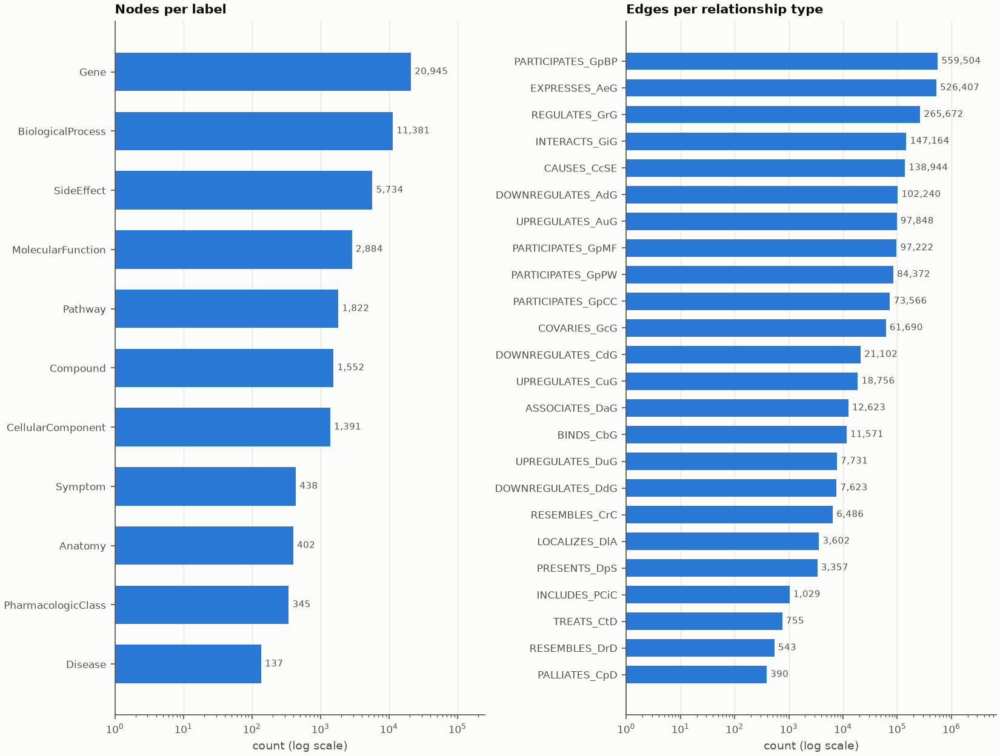

Gene is the largest label with 20,945 of 47,031 nodes. PARTICIPATES_GpBP is the largest relationship type with 559,504 edges; the smallest is PALLIATES_CpD with 390.

### B2. Metagraph

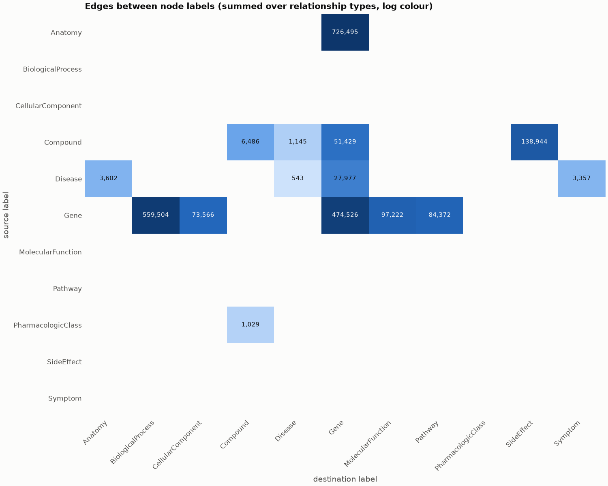

15 directed label pairs are connected by at least one relationship type. The densest is Anatomy -> Gene with 726,495 edges.

### B3. Degrees

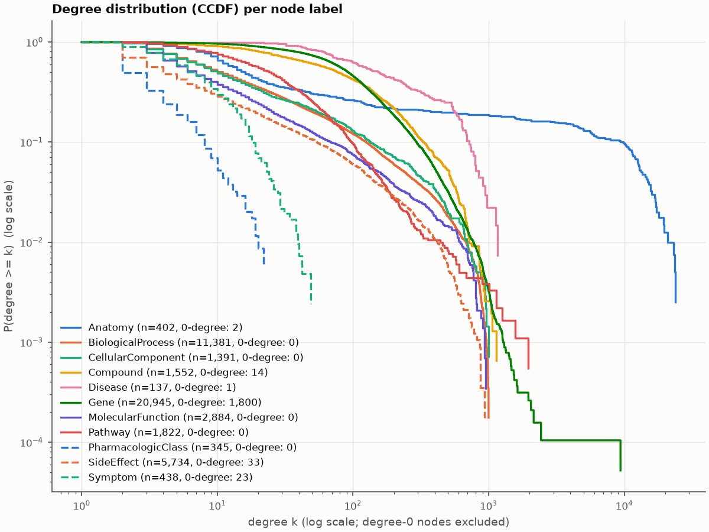

Gene degree has Gini 0.54 and median 82, but the top hub, UBC, has 9,372 edges. Top 5 genes by degree (ties alphabetical): UBC, APP, PCNA, CDC20, RPS4Y1.

| label | n | isolated | median | mean | p99 | max | gini |
|---|---|---|---|---|---|---|---|
| Anatomy | 402 | 2 | 15 | 1,816 | 19,696 | 23,879 | 0.873 |
| BiologicalProcess | 11,381 | 0 | 10 | 49.2 | 677 | 999 | 0.767 |
| CellularComponent | 1,391 | 0 | 9 | 52.9 | 667 | 1,000 | 0.778 |
| Compound | 1,552 | 14 | 75 | 132 | 712 | 1,140 | 0.573 |
| Disease | 137 | 1 | 151 | 271 | 1,070 | 1,159 | 0.526 |
| Gene | 20,945 | 1,800 | 82 | 123 | 736 | 9,372 | 0.542 |
| MolecularFunction | 2,884 | 0 | 6 | 33.7 | 599 | 955 | 0.793 |
| Pathway | 1,822 | 0 | 23 | 46.3 | 351 | 1,956 | 0.613 |
| PharmacologicClass | 345 | 0 | 1 | 2.98 | 18.6 | 22 | 0.496 |
| SideEffect | 5,734 | 33 | 3 | 24.2 | 412 | 932 | 0.82 |
| Symptom | 438 | 23 | 5 | 7.66 | 36.5 | 49 | 0.489 |

### B4. Coverage

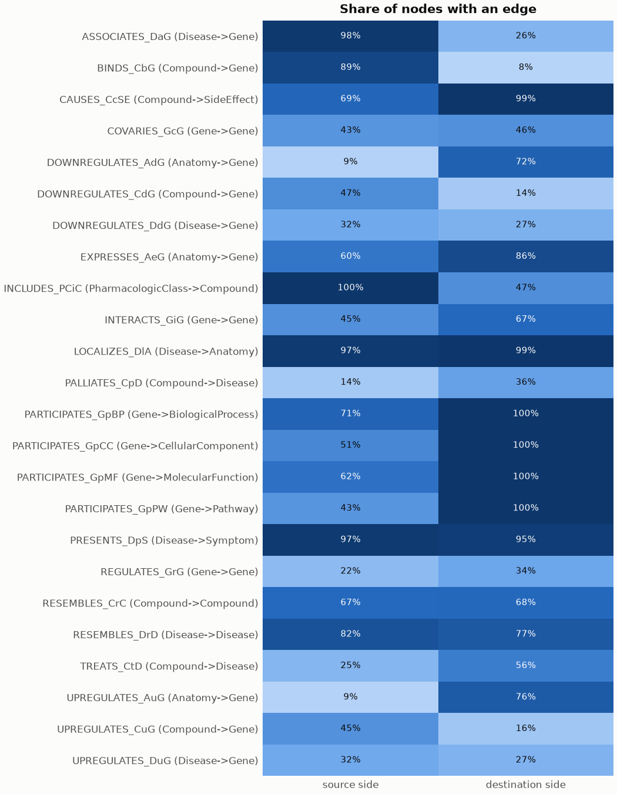

8.1% of genes are bound by a compound (BINDS_CbG) and 24.9% of compounds treat a disease (TREATS_CtD). The lowest source-side coverage is 9.0% for 2 types (DOWNREGULATES_AdG, UPREGULATES_AuG).

### B5. Completeness

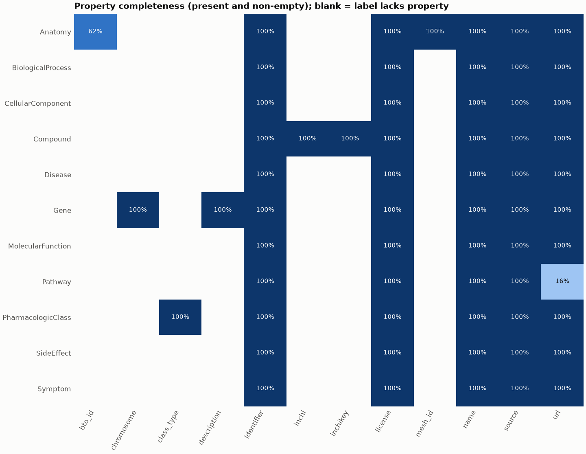

3 of 62 label-property combinations are less than fully populated; the emptiest are Pathway.url (16.1%), Anatomy.bto_id (61.7%), Gene.chromosome (99.8%).

### B6. Provenance

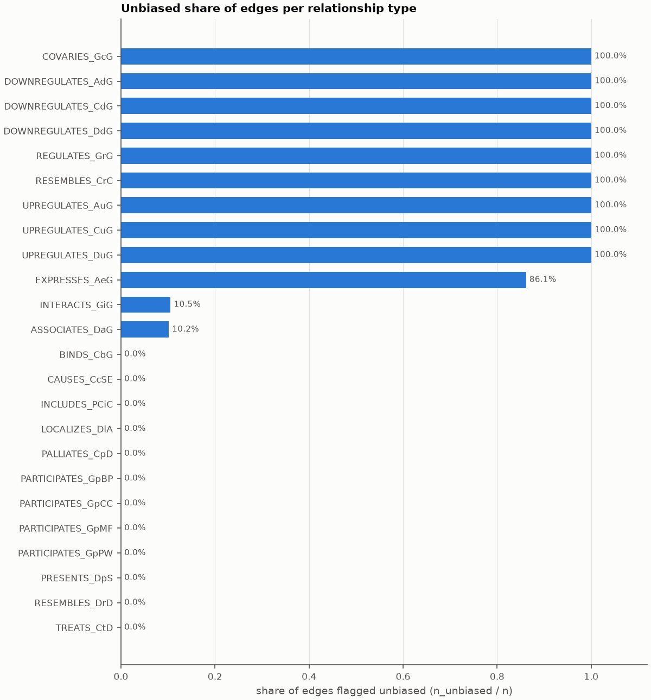

Edges come from 40 distinct sources. The share of edges flagged unbiased ranges from 0.0% for 12 types (BINDS_CbG, CAUSES_CcSE, INCLUDES_PCiC, ...) to 100.0% for 9 types (COVARIES_GcG, DOWNREGULATES_AdG, DOWNREGULATES_CdG, ...).

## 2. Data quirks

### Q1. Treatments

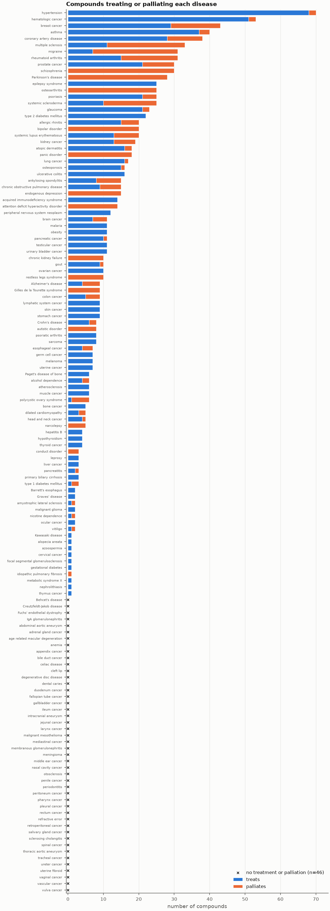

46 of 137 diseases have no treating or palliating compound: abdominal aortic aneurysm, adrenal gland cancer, age related macular degeneration, anemia, appendix cancer, Behcet's disease, bile duct cancer, celiac disease, cleft lip, Creutzfeldt-Jakob disease, degenerative disc disease, dental caries, duodenum cancer, fallopian tube cancer, Fuchs' endothelial dystrophy, gallbladder cancer, IgA glomerulonephritis, ileum cancer, intracranial aneurysm, jejunal cancer, larynx cancer, malignant mesothelioma, mediastinal cancer, membranous glomerulonephritis, meningioma, middle ear cancer, nasal cavity cancer, otosclerosis, penile cancer, periodontitis, peritoneum cancer, pharynx cancer, pleural cancer, rectum cancer, refractive error, retroperitoneal cancer, salivary gland cancer, sclerosing cholangitis, spinal cancer, thoracic aortic aneurysm, tracheal cancer, ureter cancer, uterine fibroid, vaginal cancer, vascular cancer, vulva cancer. 0 compound-disease pairs carry both TREATS and PALLIATES. Most-treated diseases: hypertension (70), hematologic cancer (53), breast cancer (43), asthma (40), coronary artery disease (38).

### Q2. Graph structure

Self-loops, reciprocal pairs and parallel edges in same-label relationship types:

| rel_type | self_loops | reciprocal_pairs | parallel_pairs |
|---|---|---|---|
| INTERACTS_GiG | 0 | 0 | 0 |
| COVARIES_GcG | 0 | 0 | 0 |
| REGULATES_GrG | 0 | 1,689 | 0 |
| RESEMBLES_CrC | 0 | 0 | 0 |
| RESEMBLES_DrD | 0 | 0 | 0 |

### Q3. Contradictions

Entities that both up- and down-regulate the same gene (pairs of entity and gene):

| source_label | pairs | entities |
|---|---|---|
| Compound | 0 | 0 |
| Disease | 0 | 0 |
| Anatomy | 0 | 0 |

### Q4. Names

Counts are over named nodes per label. `all_lower` = name equals its lowercase form; `has_punct` = contains any of `,()[]/'`.

| label | n | all_lower | starts_upper | non_ascii | has_punct | dup_names |
|---|---|---|---|---|---|---|
| Anatomy | 402 | 396 | 0 | 0 | 0 | 0 |
| BiologicalProcess | 11,381 | 9,302 | 502 | 0 | 446 | 0 |
| CellularComponent | 1,391 | 916 | 332 | 0 | 71 | 0 |
| Compound | 1,552 | 0 | 1,552 | 0 | 1 | 0 |
| Disease | 137 | 123 | 12 | 0 | 8 | 0 |
| Gene | 20,945 | 0 | 20,944 | 0 | 0 | 2 |
| MolecularFunction | 2,884 | 1,857 | 467 | 0 | 462 | 0 |
| Pathway | 1,822 | 8 | 1,763 | 4 | 253 | 6 |
| PharmacologicClass | 345 | 1 | 340 | 0 | 6 | 0 |
| SideEffect | 5,734 | 0 | 5,732 | 0 | 63 | 0 |
| Symptom | 438 | 0 | 438 | 0 | 70 | 0 |

279 lowercased names occur under more than one label. First 15:

| name_lower | labels |
|---|---|
| abdominal aortic aneurysm | Disease\|SideEffect |
| abdominal pain | SideEffect\|Symptom |
| ache | Gene\|SideEffect |
| acquired immunodeficiency syndrome | Disease\|SideEffect |
| acute coronary syndrome | SideEffect\|Symptom |
| acute pain | SideEffect\|Symptom |
| adrenal gland cancer | Disease\|SideEffect |
| ageusia | SideEffect\|Symptom |
| agnosia | SideEffect\|Symptom |
| albuminuria | SideEffect\|Symptom |
| amaurosis fugax | SideEffect\|Symptom |
| amblyopia | SideEffect\|Symptom |
| amnesia | SideEffect\|Symptom |
| androgen receptor signaling pathway | BiologicalProcess\|Pathway |
| angina pectoris | SideEffect\|Symptom |

### Q5. Study bias

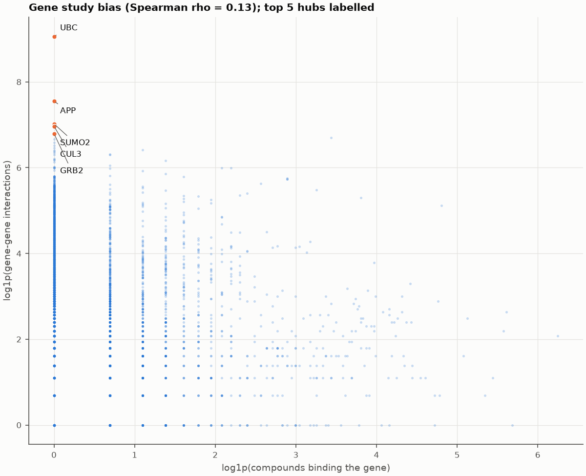

Interaction degree and number of binding compounds have a weak rank correlation (Spearman rho 0.13). 37 genes have no chromosome value.

### Q6. Edge weights

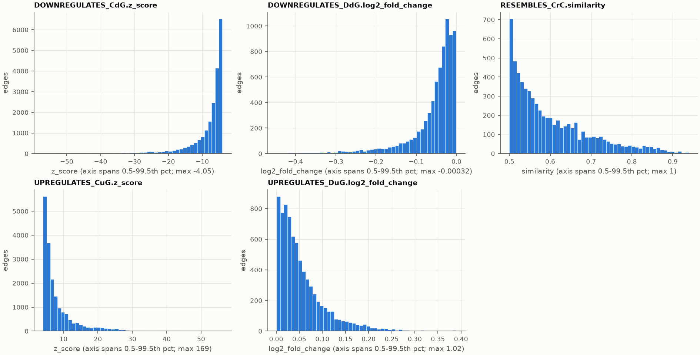

| rel_type | property | n | min | median | max |
|---|---|---|---|---|---|
| DOWNREGULATES_CdG | z_score | 21,102 | -195 | -6.11 | -4.05 |
| DOWNREGULATES_DdG | log2_fold_change | 7,623 | -1.1 | -0.0364 | -0.00032 |
| RESEMBLES_CrC | similarity | 6,486 | 0.5 | 0.571 | 1 |
| UPREGULATES_CuG | z_score | 18,756 | 4.05 | 6.15 | 169 |
| UPREGULATES_DuG | log2_fold_change | 7,731 | 0.00022 | 0.0399 | 1.02 |

### Q7. Drug classes

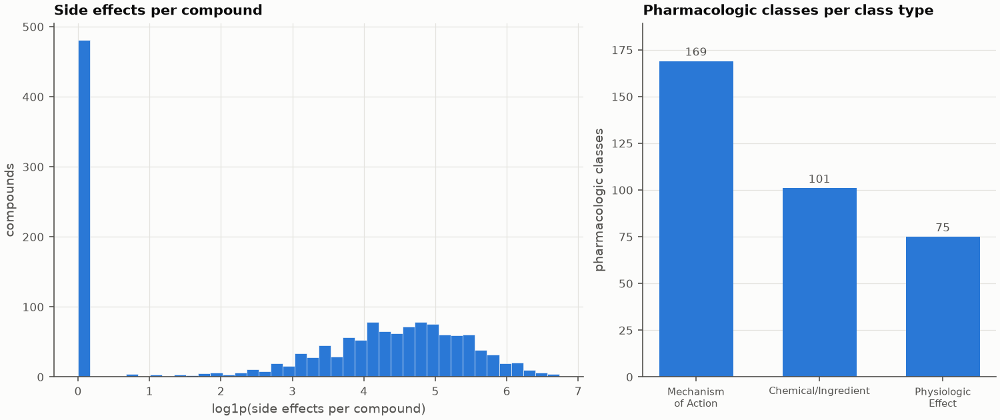

828 of 1,552 compounds belong to no pharmacologic class.

| class_type | classes | median_compounds |
|---|---|---|
| Chemical/Ingredient | 101 | 1 |
| Mechanism of Action | 169 | 2 |
| Physiologic Effect | 75 | 1 |

## 3. Repurposing signal

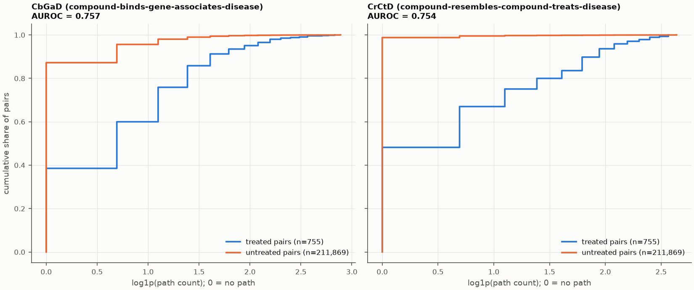

Over all Compound x Disease pairs, path counts separate treated from untreated pairs with AUROC 0.757 for CbGaD (compound-binds-gene-associates-disease) and 0.754 for CrCtD (compound-resembles-compound-treats-disease).

Caveat: the AUROC describes association within the 2017 snapshot and does not validate predictions.

## 4. Implications for the agent benchmark

- **Trap questions.** 46 diseases have no treating or palliating compound (e.g. abdominal aortic aneurysm, adrenal gland cancer, age related macular degeneration, anemia, ...); asking which compounds treat them has an empty gold answer, so a correct agent must say nothing was found rather than guess.
- **Casing.** 123 of 137 disease names are fully lowercase (the rest contain capitals) while 1,552 of 1,552 compound names start with a capital, so exact-match filters such as `name = 'Metformin'` fail on the wrong case.
- **Punctuation and encoding.** 1 of 1,552 compound names contains punctuation (,()[]/') and 4 names across all labels contain non-ASCII characters, which exact string matches must reproduce character for character.
- **Shared names.** 279 names occur under more than one label (e.g. abdominal aortic aneurysm, abdominal pain, ache, ...), and 8 names are duplicated within their own label, so queries without a label or `DISTINCT` can return extra rows.
- **Hub bias.** Questions about top genes (UBC, APP, PCNA, ...) return very large result sets: UBC alone has 9,372 edges against a median gene degree of 82, far beyond the row cap an agent sees.
- **Repurposing questions.** Path counts are an informative but far from decisive signal (AUROC 0.757 for CbGaD, 0.754 for CrCtD), so agent rankings built on them are not a substitute for the gold answer; gold rankings tie-break alphabetically by name.

## 5. Unexpected findings

Promoted from a bounded open-ended exploration (at most 3 findings; the full probe log, including dead ends, is in `EXPLORATION.md` and `probes.jsonl`).

### Drugs listed as causing the disease they treat

*Classification: unexplained.* Of the 441 TREATS edges into the 36 treated diseases that share their name with a side effect, 65 (14.7%) come from a compound also listed as causing that side effect, 1.9 times the 34.3 expected if treating compounds caused it as often as all 1,552 compounds do.

### Genes listed on both X and Y

*Classification: real biology.* 18 genes are listed on both chromosomes X and Y (`X|Y`), e.g. AKAP17A and ASMT, so an exact filter such as `chromosome = 'X'` misses them.

### Isolated genes are mostly LOC placeholders

*Classification: modelling artefact.* 1,463 of the 1,800 isolated genes (81.3%) are genes whose names start with `LOC`, and 94.5% of all 1,548 `LOC` genes have no edge at all.
